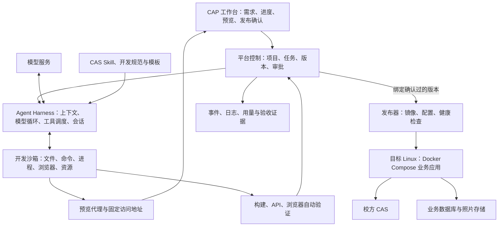

# CAP 应用开发平台 PoC：技术选型清单

- 日期：2026-11-05
- 状态：供用户决策；候选不按主备排序，尚未完成实机对比。
- 范围：[已对齐的 PoC 目标](../../ai-workbench/docs/jaden-self-use/cap-app-dev-platform/CAP应用开发平台-PoC目标与范围.md)：Web 报修两端、CAS、单机 Linux 发布、一次对话修改后保留数据。
- 深入依据：[Agent 运行框架与开发沙箱候选分析](research/Agent运行框架与开发沙箱候选分析.md)；案例证据见 [REA 取证报告](research/扣子编程-REA取证报告.md)。

## 1. 技术全景与决策顺序

平台需要的核心组合是 **模型服务 + 编程 Harness + 开发沙箱 + 平台编排 + 验证与发布**。

这是逻辑分层，尚不指定 Harness 部署在控制侧还是沙箱内。优先决定 **Harness、沙箱、模型接入**；其余配套技术可随后选择，已有设施可直接复用。

| 技术层 | 必须解决的问题 | 候选入口 |
| --- | --- | --- |
| AI 编程 | 谁管理模型请求、工具循环、上下文和继续对话 | DSH、Pi、Codex、OpenCode、OpenHands |
| 开发环境 | 代码在哪里执行，如何管理文件、进程、端口和存续 | OpenSandbox、E2B Embed、自管 Docker + gVisor |
| 平台编排 | 谁管理开发、验证、预览确认、发布和失败处理 | 自有状态机、LangGraph、Temporal |
| 验证与交付 | 如何验证页面、提供预览并发布到学校服务器 | 浏览器测试框架、反向代理、Compose/PaaS |
| 数据与运营 | 如何保存源码、会话、业务数据与执行证据 | Git、数据库、文件存储、观测工具 |

“能力必需”不代表必须为每层新装一个平台；候选也不意味着需要全部采用。

## 2. Agent Harness：AI 编程运行框架

Harness 负责模型—工具循环、上下文、工具结果回灌、继续/停止、会话和扩展机制。SDK、HTTP 或 JSON-RPC 是接入方式，不能单独作为底层选型依据。

| 候选与链接 | 主要优点 | 主要缺点／接入代价 | 开源边界 |
| --- | --- | --- | --- |
| [DeepSeek Harness（DSH）](https://github.com/deepseek-ai/deepseek-harness) | 默认 loop、Skill registry、事件源 Session、工具 pipeline 均可通过插件与能力后端扩展，适合研究和控制 Harness 策略。 | 需理解 Cordis/profile；开发预览期存在破坏性变动；当前 SDK 的超时不等于取消，OpenSandbox 后端需适配。 | MIT；模型服务、插件和第三方依赖另计。 |
| [Pi coding-agent](https://github.com/earendil-works/pi/tree/main/packages/coding-agent) | 可嵌入的编程 Harness；循环钩子、资源加载器、extensions、工具 Operations 提供较明确的定制面。 | 无内置 OS 权限隔离；远程工具、资源读取、事件耐久性和产品状态需要自己补齐。 | MIT；不同 Pi 层次不可混用。 |
| [Codex Harness / app-server](https://learn.chatgpt.com/docs/app-server) | 现成编程循环与文档化的线程、轮次、事件、审批和中断协议，可封装自有 UI。 | 自定义模型需满足 Responses 协议；深改内核涉及既有实现；MCP/动态工具不自动替换所有内置文件和命令执行。 | Harness 与接入组件开源；模型访问和托管服务独立。 |
| [OpenCode](https://github.com/anomalyco/opencode) | 已有编程 Harness、会话、Skill、多 provider 和自托管 server 接口，适合在现有执行体系上产品化。 | 策略定制要理解其 session/runner/plugin 体系；v2 实时订阅无自动重放，CAP 需补事件恢复与状态核对。 | [MIT](https://github.com/anomalyco/opencode/blob/dev/LICENSE)；server 是开源项目的一部分，TypeScript client 只是访问接口。 |
| [OpenHands Software Agent SDK](https://github.com/OpenHands/software-agent-sdk) | Agent Server、工作区、浏览器工具与会话持久化已有可组合实现。 | 主要运行侧为 Python；与 OpenSandbox 的组合仍需验证工作区、执行器和生命周期适配。 | SDK 主仓 MIT；不等于所有企业服务一并开源。 |

### Pi 需要进一步选层

| Pi 层次 | 已提供 | 选择它意味着什么 |
| --- | --- | --- |
| [pi-agent-core](https://github.com/earendil-works/pi/tree/main/packages/agent) | 模型/工具循环、状态和钩子。 | 自控更底层，但需补编程资源、工具、压缩与会话管理。 |
| [pi-coding-agent](https://github.com/earendil-works/pi/tree/main/packages/coding-agent) | 编程工具、Skill、上下文、会话、压缩与扩展。 | 复用完整编程 Harness，再实现 CAP 策略和沙箱接入。 |
| [pi-durable](https://github.com/earendil-works/pi/tree/main/packages/durable) | 独立耐久任务 Harness、Storage、ExecutionEnv。 | 实验性路线；不是 coding-agent 的持久化开关，需要额外资源和扩展桥接。 |

**本层决策重点：**需要定制到什么程度、目标模型能否接入、如何停止任务、会话怎样恢复，以及工作区工具能否全部进入沙箱。未做质量实测前，不以语言一致或“有 SDK”判定优劣。

## 3. 开发沙箱：工作区执行与生命周期

| 候选与链接 | 主要优点 | 主要缺点／接入代价 |
| --- | --- | --- |
| [OpenSandbox](https://github.com/opensandbox-group/OpenSandbox) | 生命周期、命令、文件、端口 SDK 成套；Docker 后端能利用现有 Linux/Docker 环境，镜像和运行时可配置。 | 默认不是微 VM；源码/会话持久化、预览入口鉴权和发布仍由 CAP 管理；Docker 后端有具体功能限制。 |
| [E2B Embed](https://e2b.dev/resources/introducing-e2b-embed) | 官方单机自托管方案，含 Firecracker、SDK、模板/快照与控制面；Apache-2.0。 | 需要专用 Linux/KVM；完整栈运维更重；发布说明不含 volumes、secrets、workload identity，持久工作区需另验。 |
| [Docker + gVisor + 自建执行服务](https://gvisor.dev/docs/user_guide/quick_start/docker/) | 可精确裁剪运行环境和执行契约，采用用户态内核边界。 | gVisor 只是运行时；exec/files、TTL、事件、端口代理和会话管理都需建设，还需验证构建与浏览器兼容性。 |

### Harness 与沙箱的两种组合方式

| 方式 | 优点 | 缺点 |
| --- | --- | --- |
| **Harness 整体运行在沙箱中** | 内置文件、shell、资源加载和扩展使用同一执行世界，原生行为较易保留。 | 要管理 Harness 进程和服务桥、状态目录、模型网络及凭据；重建后需恢复会话。 |
| **Harness 在控制侧，工具远程进入沙箱** | 模型配置、策略和会话可集中管理，开发环境可独立回收。 | 必须完整覆盖文件、shell、图片、搜索及扩展的执行路径；只替换 bash 接口会留下宿主访问路径。 |

选择 OpenSandbox 时至少核对：

1. 创建、命令流、文件和端口接口是否覆盖所选 Harness。
2. 源码卷、Harness 会话卷和验收产物的独立生命周期。
3. TTL、续期、取消和容器重建后的状态核对。
4. 固定预览域名、访问鉴权、CAS 回调和 HMR。
5. 实际安全运行时、网络策略与服务器硬件是否兼容。

本次核查的 OpenSandbox release-1.2.0 中，Docker pause 是冻结；Docker 不支持 secureAccess 签名入口；gVisor 与 networkPolicy 的组合被拒绝。候选功能必须按固定版本及后端验证，详见 [源码依据](research/Agent运行框架与开发沙箱候选分析.md)。

## 4. 模型服务：编程推理与工具调用

这是独立于 Harness 的决策；API 兼容不等于编程效果和上下文语义完全相同。

| 候选与链接 | 主要优点 | 主要缺点／接入代价 |
| --- | --- | --- |
| [DeepSeek API](https://api-docs.deepseek.com/) | 有官方 Harness 与多类 Agent 接入说明，可利用托管推理及兼容协议。 | 需核对目标模型的工具、视觉、上下文和 Harness adapter；源码与测试资料的出网边界需确认。 |
| [阿里云百炼／千问 API](https://help.aliyun.com/zh/model-studio/compatibility-of-openai-with-dashscope) | 有 OpenAI 兼容接口与模型服务选择，可利用既有企业云资源。 | 各模型能力与地域、协议支持不同，不能只更换 base URL 就认定 Harness 兼容。 |
| [OpenAI API](https://developers.openai.com/api/docs/guides/code-generation) | 有编程模型和工具调用接口，可与 Codex 路线对照。 | 需确认账户、网络、数据和使用成本；模型服务不因 Harness 开源而可自部署。 |
| [vLLM 私有推理路线](https://docs.vllm.ai/en/latest/serving/online_serving/) | 可在获准的自有算力上托管受支持模型，控制数据与服务位置。 | 需另选模型权重、GPU、容量与运维；兼容接口不自动满足所有 Harness 语义。 |

前三项是托管 API，vLLM 是自管推理方案，需要承担不同的资源成本。本稿不将未实测的模型质量、速度或价格作排序。

## 5. 编程流程与任务编排

Harness 内层负责工具循环；外层负责“开发 → 验证 → 待确认 → 发布”等产品状态。

| 候选与链接 | 主要优点 | 主要缺点／接入代价 |
| --- | --- | --- |
| **Harness 回调 + 自有持久状态机**（基础存储可用 [PostgreSQL](https://www.postgresql.org/docs/)） | 结构可裁剪，直接围绕本轮固定流程建设。 | 取消、重试、并发锁、事件顺序和恢复规则需要自己实现。 |
| [LangGraph + 已选 Harness](https://docs.langchain.com/oss/python/langgraph/overview) | 图状态、条件分支、checkpoint 和人工中断有明确抽象，适合显式表达策略。 | 要对接 Harness 自有会话与状态；外部工具副作用和进程恢复仍需处理。 |
| [Temporal + 已选 Harness](https://docs.temporal.io/temporal) | 适合长任务、等待确认和跨步骤故障恢复，有工作流历史与重试机制。 | 增加服务与 deterministic workflow/Activity 的工程约束；Agent 和发布操作仍需设计幂等性。 |

它们不会自动提供编程工具或沙箱。采用现成 Harness 后，编排器可只负责外层流程，避免同时维护两套相互竞争的模型循环。

## 6. Skill 与工具接入

[Agent Skills](https://agentskills.io/home) 用于提供知识、步骤和资源；执行能力仍需要真实工具。CAS Skill 与最终应用的 CAS 会话代码分别建设，校方 CAS 本身是本轮已定系统。

| 工具接入候选 | 主要优点 | 主要缺点／接入代价 |
| --- | --- | --- |
| **Harness 原生工具／插件**：见各 Harness SDK | 事件、上下文和执行控制可深入接入，少一层传输。 | 绑定框架 API；插件运行在哪一侧就具有哪一侧的进程权限。 |
| [MCP](https://modelcontextprotocol.io/docs/getting-started/intro) | 工具 schema 与调用协议可跨 Harness 复用，适合统一校园能力工具入口。 | 需部署服务、鉴权和协议适配；不会自动接管 Harness 所有内置工具。 |
| **受控 CLI**：如本地 cap 命令规范（格式可参考 [Git CLI](https://git-scm.com/docs/git)） | 便于沙箱中调用，易与已有工程脚本衔接。 | 必须定义结构化输入输出、退出码、超时与幂等；自然语言日志不能当稳定协议。 |

三种通道可组合。实际 Skill 目录应固定审核版本、按需加载，记录配置、激活和正文读取，避免将已选择视为已执行。下载的扣子 Skill 还需适配其 CLI、SDK 和服务依赖。

## 7. 工作区、源码与会话存储

运行中的目录、Git 版本和 Harness 会话是不同对象。下列三种方案均需保留本地工作区；远程 Git 不能代替会话卷或未提交文件。

| 候选方案与链接 | 主要优点 | 主要缺点／接入代价 |
| --- | --- | --- |
| [持久卷](https://docs.docker.com/engine/storage/volumes/) + [本地 Git](https://git-scm.com/docs/git-worktree) | 单机依赖少，可保存源码、分支和版本。 | 备份、目录映射、权限和会话卷管理由 CAP 实现。 |
| 持久工作区 + [Gitea](https://docs.gitea.com/) | 可自托管，提供代码托管、权限及基础协作。 | 增加服务和账号、凭据、同步故障处理；仍需本地卷。 |
| 持久工作区 + [GitLab](https://docs.gitlab.com/) | 代码治理、流水线和企业研发设施可复用。 | 运维与集成面更大；完整 IDE 双向协同仍超出本轮范围。 |

会话优先采用所选 Harness 的原生格式并独立持久化，CAP 保存关联 ID 和自身事件；是否集中存数据库取决于恢复与审计需求。

## 8. 预览入口与访问代理

沙箱 endpoint 是内部连接信息，老师需要的是受控、稳定的浏览器入口。代理需支持 HTTP/WebSocket、预览鉴权、CAS 的外部地址和证书配置。

| 候选与链接 | 主要优点 | 主要缺点／接入代价 |
| --- | --- | --- |
| [Nginx](https://nginx.org/en/docs/) | 路由和访问控制明确，便于接既有学校反向代理。 | 动态沙箱路由、配置更新和回收机制需自行管理。 |
| [Traefik](https://doc.traefik.io/traefik/) | 动态配置与容器发现适合多个临时入口。 | 需限制其容器发现权限，设计标签、路由和鉴权规则。 |
| [Caddy](https://caddyserver.com/docs/) | 配置与动态 API 简洁，证书能力集成度高。 | 私网证书与信任、动态路由、学校域名条件仍需处理。 |

无论选哪个，都不能假设 CAS 登录页面可在预览 iframe 中打开；必须验证顶层跳转、Cookie、回调白名单和 HMR。

## 9. 自动验证与失败修复

构建、类型、API 权限与浏览器交互都要验证；以下候选主要解决浏览器验收。

| 候选与链接 | 主要优点 | 主要缺点／接入代价 |
| --- | --- | --- |
| [Playwright](https://playwright.dev/docs/intro) | 浏览器、移动视口、API 请求、截图与 trace 可整合进测试流程。 | 需维护浏览器镜像、断言、账号和测试数据。 |
| [Cypress](https://docs.cypress.io/app/get-started/why-cypress) | 交互调试与组件测试体验完整，前端团队容易查看失败过程。 | CAS 跨域、多页面和 CI 场景需按其机制适配。 |
| [WebdriverIO](https://webdriver.io/docs/why-webdriverio) | 可复用 WebDriver/BiDi 及既有自动化测试设施。 | 驱动、运行器和测试配置组合需要维护。 |

项目已有约定优先使用 Playwright，最终选择仍记录在决策表。Agent 可获得失败反馈；验收断言、实际回执和通过状态由平台管理。

## 10. 单机发布运行

本轮目标已经限定 Docker/Compose；这里选择的是谁负责构建、配置、更新和运维。

| 候选与链接 | 主要优点 | 主要缺点／接入代价 |
| --- | --- | --- |
| [Docker Compose + 自有发布 Worker](https://docs.docker.com/compose/how-tos/production/) | 范围最可裁剪，可直接绑定 CAP 的确认、版本与健康检查。 | 镜像、配置、日志、更新失败和数据卷规则需自建。 |
| [Coolify](https://coolify.io/docs/core/what-is-coolify) | 自有服务器上已有应用、数据库、域名和部署管理及 API。 | 增加 PaaS 运维和权限集成；远程管理使用 SSH，需符合校方网络条件。 |
| [Dokploy](https://docs.dokploy.com/docs/core) | 有 Compose、域名、数据库及部署管理能力，可减少运维界面开发。 | 增加平台组件与 API/权限适配；社区与企业功能边界需核对。 |

发布模板、镜像摘要、配置引用和数据卷身份由可信组件控制。代码更新不重置业务数据；发布尝试、阶段状态和在线版本分别保存。

## 11. 配套底座：按需要复用或选择

### 11.1 Web 应用模板

| 候选与链接 | 优点 | 缺点／代价 |
| --- | --- | --- |
| [Next.js](https://nextjs.org/docs/app/getting-started/deploying) | 全栈路由和 API 集中；与现有报修案例一致。 | 需统一服务端/客户端边界和生产构建约定。 |
| [React/Vite](https://vite.dev/guide/) + [NestJS](https://docs.nestjs.com/) | 前后端职责清晰，可复用独立 API 服务。 | 多一个服务与接口、部署契约，模板维护面增加。 |
| [Nuxt](https://github.com/nuxt/nuxt) | Vue 全栈路线，适合已有 Vue 工程积累的团队。 | 现有 Next.js 案例和部分技能需要重写适配。 |

### 11.2 平台／业务数据库

| 候选与链接 | 优点 | 缺点／代价 |
| --- | --- | --- |
| [PostgreSQL](https://www.postgresql.org/docs/) | 可集中保存业务与平台元数据，权限和迁移由应用明确管理。 | 数据 API、鉴权、管理工具和备份需自行组织。 |
| [SQLite](https://www.sqlite.org/whentouse.html) | 嵌入式部署简单，适合受限的单机验证。 | 集中并发写入、扩展和多服务共享需评估，不能直接沿用 Supabase HTTP 契约。 |
| [自托管 Supabase](https://supabase.com/docs/guides/self-hosting) | 接近既有案例的 HTTP 数据操作与平台服务形态。 | 服务栈更大；Coze 客户端注入、迁移命令和 CAS 身份仍需适配。 |

平台任务、Harness 原生日志和报修业务数据应明确归属，不能因为使用同一数据库就混成同一种状态。

### 11.3 照片与验收产物

| 候选方案与链接 | 优点 | 缺点／代价 |
| --- | --- | --- |
| [本地持久卷](https://docs.docker.com/engine/storage/volumes/) + 应用文件 API | 单机依赖少，文件与业务权限可集中控制。 | 备份、配额、授权读取和跨主机迁移需自己负责。 |
| 已有学校对象存储，采用 [S3 API](https://docs.aws.amazon.com/AmazonS3/latest/API/Welcome.html) 兼容方式 | 业务容器与文件存储分离，可利用已有存储设施。 | 必须核对实际服务、签名与网络；不能继续依赖 Coze 隐式身份和签名接口。 |

### 11.4 可观测与评估

日志、用量和验收记录必须有；独立观测产品可选。

| 候选与链接 | 优点 | 缺点／代价 |
| --- | --- | --- |
| 自有事件表 + [OpenTelemetry](https://opentelemetry.io/docs/) | 自定项目/版本/工具事件契约，便于控制数据位置。 | 需要接存储、查询和 UI；OTel 本身不是完整观测后台。 |
| [Langfuse](https://langfuse.com/docs) | 自托管的 LLM 观测、prompt 和评估能力可复用。 | 增加部署服务与埋点；Harness 事件仍需映射和脱敏。 |
| [LangSmith](https://docs.langchain.com/langsmith/observability) | tracing、数据集与评估能力成体系，多框架接入。 | 服务授权、成本及私有化方式需另核对。 |

## 12. 决策与验证口径

本稿不替用户确定技术组合。第一轮先填写：

| 待决策项 | 当前状态 | 选择时优先回答 |
| --- | --- | --- |
| Harness | 待选择 | 需要修改 loop 到什么程度？可接受哪些协议和框架维护成本？ |
| 开发沙箱 | 待选择 | 目标主机有无 KVM？需要何种隔离和持久化语义？ |
| 模型接入 | 待选择 | 允许哪些 API/数据出口？是否已有公司或校内模型？ |

后续再选择编排、工具通道、预览代理、验证、发布及可复用底座。

候选对比应固定需求、模板、Skill、执行环境与预算；能接同一模型时使用同一模型。不同模型与 Harness 的组合结果，不应直接解释为 Harness 本身优劣。

验证记录至少包含五项：

1. 报修生成与 CAS 关键路径是否通过。
2. 人工介入、修复轮次与失败类型。
3. 耗时、模型用量及实际运行成本。
4. 取消、容器重建、会话继续和事件完整性。
5. V1/V2 发布后原工单、照片、处理记录和 URL 是否保留。

当前只完成资料、源码与候选边界核查；尚未部署或实测这些组合。
