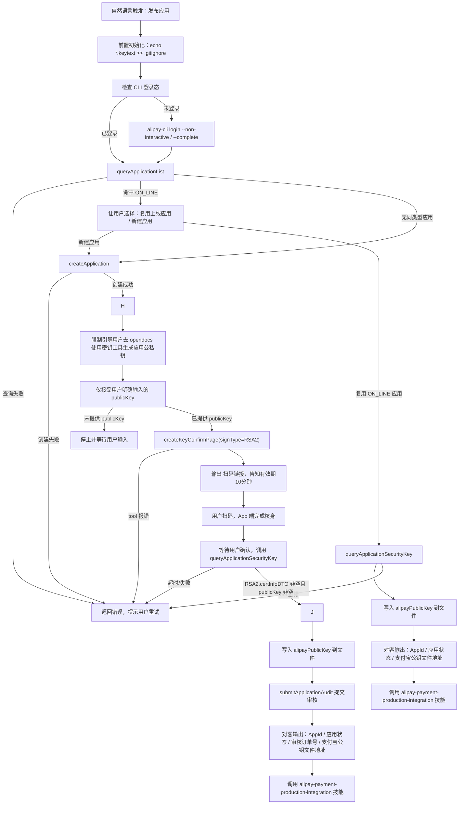

# Application Publish Sub Skill

这是“支付能力接入主 skill”下的发布子 skill。它通过 `alipay-cli` 调用 `apprelease` MCP server，再由后端承接对应 TR。这里只保留入口、路由和阅读导航。
一期只支持 `WEBAPP`。

## 触发

- 对客只能自然语言触发
- 主入口是 `发布应用`
- 可机读调用统一按 CLI `--json`
- 内部子能力：
  - `创建应用`
  - `设置应用公钥`
  - `提交应用审核`
  - `恢复发布流程`
  - `查询发布状态`

## 路由

- 采用智能意图路由
- 无法判断用户意图时先问清楚，不自动调 tool
- 先检查 CLI 登录态，再按 `查询已有应用 -> 创建或复用 -> 设置应用公钥 -> 提交审核` 推进
- tool 报错时直接返回错误，由用户决定下一步
- `设置应用公钥` 是混合工作流节点，细节见 `references/flow.md`
- 除自动主流程外，用户明确要求“一步一步操作”时，可以进入显式分步模式
- 显式分步模式下仍必须遵守 MCP 入参契约和安全规范

## 全局规范


### 公钥私钥敏感性规范（强制执行）

<important>
**公钥私钥属于敏感信息，必须严格遵守以下规范：**

1. **禁止生成或建议生成密钥**：
   - 严禁向用户表示可以”帮助生成公钥”、”帮助生成密钥对”、”我来生成应用公私钥”等
   - 严禁提供任何密钥生成代码、命令或脚本
   - 严禁使用 `openssl`、`ssh-keygen` 等工具为用户生成密钥

2. **禁止接收私钥**：
   - 严禁请求、接收或处理用户的私钥信息
   - 不得要求用户提供私钥内容
   - 不得存储、记录或传输私钥

3. **仅接受公钥输入**：
   - 只能接收用户明确提供的 `publicKey`（应用公钥）
   - 用户必须自行生成密钥对
   - skill 不生成、不推断、不改写公钥

4. **引导用户使用官方工具**：
   - 设置应用公钥时，必须引导用户前往支付宝开放平台官方密钥生成工具
   - 官方工具地址：https://opendocs.alipay.com/common/02kipk

5. **标准引导话术**：
   - 引导时使用标准话术：”请前往支付宝开放平台密钥生成工具（https://opendocs.alipay.com/common/02kipk）下载并使用官方工具生成应用公私钥对，生成后将应用公钥提供给我继续后续流程。**私钥请妥善保管，切勿泄露给任何人。**”
</important>

### MCP 调用规范

- 所有 MCP 调用必须严格遵循 `references/cli-command-templates.md` 中定义的参数格式
- 请求体必须以 `{“request”: {...}}` 包裹
- `uid` 和 `identityContext` 由 CLI OAuth 会话自动注入，禁止手动传递

### 应用复用强制原则

<important>
只有状态为 `ON_LINE` 的应用才允许复用，也只有 `ON_LINE` 应用允许被列出给用户选择。

- 无论是自动流程命中已有应用，还是用户自己明确说要复用某个 `appId`，都必须先查询该应用状态
- 状态不是 `ON_LINE` 时，禁止复用
- 用户坚持要求复用非 `ON_LINE` 应用时，直接拒绝该复用请求，并继续按”新建应用”路径处理
- `queryApplicationList` 的展示结果必须过滤为 `ON_LINE` 应用
</important>

### alipayPublicKey 文件写入规范

<important>
获取到 `alipayPublicKey` 后必须立即写入文件，并在以下环节告知用户文件路径：

- **文件路径**：`/workspace/projects/<appId>-alipayPublicKey.keytext`
- **写入行为**：文件不存在则创建，存在则覆盖更新
- **写入时机**：从 `queryApplicationSecurityKey` 返回的 `signType=”RSA2”` 项获取到 `alipayPublicKey` 后立即写入
- **告知时机**：
  1. **确认密钥状态时**：用户输入确认公钥，查询设置成功后
  2. **提交应用审核成功后**：`submitApplicationAudit` 返回成功后

```bash
# 写入并告知用户
echo “$ALIPAY_PUBLIC_KEY” > “/workspace/projects/${APP_ID}-alipayPublicKey.keytext”
echo “*.keytext”” >> “/workspace/projects/.gitignore”
echo “✅ 支付宝公钥已保存至: /workspace/projects/${APP_ID}-alipayPublicKey.keytext”
```
</important>

## 流程图



## 后续流程

**复用成功或设置密钥成功后自动调用支付能力集成：**

| 触发时机 | 操作顺序 |
|----------|----------|
| 复用 ON_LINE 应用成功 | 1. 写入支付宝公钥文件<br>2. **对客输出**（AppId、应用状态ON_LINE、支付宝公钥文件地址）<br>3. 调用 `alipay-payment-production-integration` |
| 设置密钥成功（新建应用） | 1. 写入支付宝公钥文件<br>2. 提交审核获取审核订单号<br>3. **对客输出**（AppId、应用状态AUDITING、审核订单号、支付宝公钥文件地址）<br>4. 调用 `alipay-payment-production-integration` |

**⛔ 输出时机铁律：必须在调用 `alipay-payment-production-integration` 之前完成对客输出。**

**对客输出格式：**

```
✅ 应用复用成功（或应用创建成功）

| 项目 | 信息 |
|------|------|
| AppId | <appId> |
| 应用状态 | ON_LINE / AUDITING |
| 审核订单号 | <auditOrderNo>（仅新建应用输出，复用不输出） |
| 支付宝公钥 | /workspace/projects/<appId>-alipayPublicKey.keytext |
```

## 说明

- 流程：`references/flow.md`
- 契约与规则：`references/contracts.md`
- 失败收口：`references/failure-handling.md`
- CLI 模板：`references/cli-command-templates.md`
