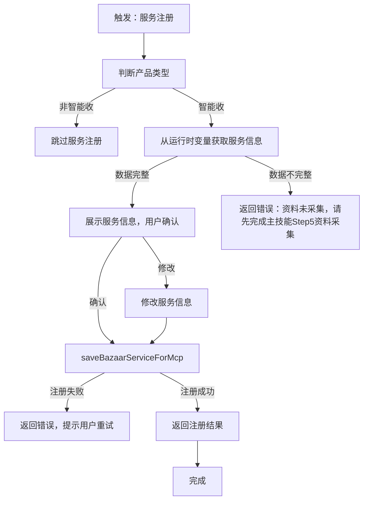
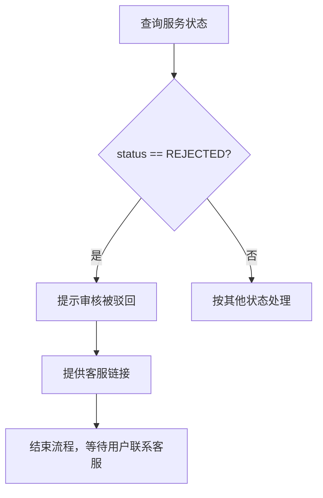

# Service Market Sub Skill

这是"支付宝商家入驻主 skill"下的服务注册子 skill。**仅在用户选择"智能收"产品时需要执行服务注册流程。** 通过 `alipay-cli` 调用 `a2a-pay-service` MCP server，实现 MCP 服务的注册操作。

## ⚠️ 重要：产品类型判断与资料采集

<重要>
**服务注册仅对"智能收"产品需要：**

- `salesCode = I1080300001000160457`（智能收）→ **需要**服务注册
- `salesCode = I1080300001000041203`（电脑网站支付）→ **不需要**服务注册

**⚠️ 资料采集已由主技能完成：** 智能收的服务注册入参（serviceName、serviceDesc、resourceUrl、pricing、schemaUrl）在主技能 Step 5 资料采集阶段已收集，作为运行时变量传递给本子技能。**不写入共享内存状态文件**（状态文件仅允许 4 个字段：productName、salesCode、scope、collect_information）。

**触发时机：**
1. 主技能 Step 5 完成资料采集后，Step 6 并行执行时自动触发
2. 从运行时变量获取服务信息，校验完整性后直接提交
</重要>

## ⚠️ 全局规范

### 严禁虚拟 MCP 方法调用

<重要>
**所有 MCP 方法调用必须严格按照本文档及 `references/cli-command-templates.md` 中声明的方式执行，禁止模型自行虚拟、推断或创建任何未定义的 MCP 调用方法。**

#### 绝对禁止

1. ❌ **禁止虚拟未定义的 MCP 方法** — 不得调用文档中未明确列出的 `a2a-pay-service.xxx` 方法
2. ❌ **禁止自行推断方法名称** — 如自行编造 `a2a-pay-service.deleteService`、`a2a-pay-service.updateService` 等未定义的方法
3. ❌ **禁止自行修改方法参数** — 必须使用文档中定义的参数名和参数结构
4. ❌ **禁止猜测返回格式** — 必须按照文档中定义的返回结构解析响应

#### 已定义的 MCP 方法（完整列表）

本 Skill 支持且仅支持以下 MCP 方法，除此之外的任何方法调用都是违规的：

| MCP Server | 方法名 | 用途 |
|------------|--------|------|
| `a2a-pay-service` | `discoverBazaarServicesForMcp` | 查询已上架的服务列表 |
| `a2a-pay-service` | `saveBazaarServiceForMcp` | 提交服务上架申请 |

#### 调用规范示例

```bash
# ✅ 正确：查询已上架服务
alipay-cli mcp call a2a-pay-service.discoverBazaarServicesForMcp \
  -d '{"request":{}}' \
  --json 2>/dev/null

# ✅ 正确：提交服务上架
alipay-cli mcp call a2a-pay-service.saveBazaarServiceForMcp \
  -d '{"request":{"serviceName":"天气查询","serviceDesc":"提供全球天气查询服务","resourceUrl":"https://api.example.com/weather","pricing":"0.01","schemaUrl":"{\"type\":\"object\",\"properties\":{\"city\":{\"type\":\"string\"}}}"}}' \
  --json 2>/dev/null

# ❌ 错误：虚拟未定义的方法
alipay-cli mcp call a2a-pay-service.deleteService -d '...'

# ❌ 错误：自行推断的方法名
alipay-cli mcp call a2a-pay-service.updateService -d '...'
```

</重要>

### MCP 调用规范

- 所有 MCP 调用必须严格遵循 `references/cli-command-templates.md` 中定义的参数格式
- 请求体必须以 `{"request": {...}}` 包裹
- `uid` 和 `identityContext` 由 CLI OAuth 会话自动注入，禁止手动传递

### 服务信息校验规范

**⚠️ 资料采集已由主技能 Step 5 完成，本子技能仅读取和校验。**

以下 5 项必填字段在主技能 Step 5 已采集，作为运行时变量传递（不写入共享内存状态文件）：

| 字段 | 说明 | 验证规则 |
|------|------|----------|
| `serviceName` | 服务名称 | 长度 1-50 字符，不得为空 |
| `serviceDesc` | 服务描述 | 长度 1-500 字符，不得为空 |
| `resourceUrl` | 服务地址 | 有效的 URL 格式，可访问 |
| `pricing` | 服务单价 | 必须 >= 0.01（单位：元） |
| `schemaUrl` | 请求示例 | 有效的 JSON 格式 |

**校验流程：**

1. 从运行时变量获取服务信息（由主技能传递）
2. 逐项校验 5 项必填字段是否完整
3. 如数据不完整，返回错误提示（需回到主技能 Step 5 补充采集）
4. 如数据完整，展示信息供用户确认后提交

## 流程图



**⚠️ 注意：登录态检查和 MCP 可用性检查由主 skill 负责，本子技能不单独处理。**

## 执行流程

### Step 1: 读取资料并校验

**⚠️ 资料采集已由主技能 Step 5 完成，本步骤仅从运行时变量获取并校验完整性。**

```bash
# 服务信息由主技能通过运行时变量传递（不存共享内存）
# SERVICE_NAME, SERVICE_DESC, RESOURCE_URL, PRICING, SCHEMA_URL 已在主技能 Step 5 采集
# ⚠️ 禁止从共享内存读取 service_market_data（状态文件仅允许 4 个字段）
```

**校验逻辑：**

```bash
# 逐项校验 5 项必填字段（运行时变量，由主技能 Step 5 传递）
# ⚠️ 禁止从共享内存状态读取 service_market_data
# SERVICE_NAME, SERVICE_DESC, RESOURCE_URL, PRICING, SCHEMA_URL 应已由主技能传入

MISSING_FIELDS=""

[ -z "$SERVICE_NAME" ] && MISSING_FIELDS="$MISSING_FIELDS serviceName"
[ -z "$SERVICE_DESC" ] && MISSING_FIELDS="$MISSING_FIELDS serviceDesc"
[ -z "$RESOURCE_URL" ] && MISSING_FIELDS="$MISSING_FIELDS resourceUrl"
[ -z "$PRICING" ] && MISSING_FIELDS="$MISSING_FIELDS pricing"
[ -z "$SCHEMA_URL" ] && MISSING_FIELDS="$MISSING_FIELDS schemaUrl"

if [ -n "$MISSING_FIELDS" ]; then
  echo "❌ 服务注册数据不完整，缺失字段：$MISSING_FIELDS"
  echo "请先完成主技能 Step 5 资料采集"
  exit 1
fi
```

**确认展示：**

```
📋 已读取服务注册信息，请确认：

┌──────────────────────────────────────────────────┐
│ 服务名称：天气查询                                │
├──────────────────────────────────────────────────┤
│ 服务描述：提供全球主要城市的实时天气和预报查询      │
├──────────────────────────────────────────────────┤
│ 服务地址：https://api.example.com/weather         │
├──────────────────────────────────────────────────┤
│ 服务单价：¥0.01/次                                │
├──────────────────────────────────────────────────┤
│ 请求示例：                                        │
│ {                                                │
│   "city": "北京"                                 │
│ }                                                │
└──────────────────────────────────────────────────┘

确认提交上架？(确认/修改/取消)
```

### Step 2: 提交注册

**方式一：直接使用单引号包裹（推荐）**

`-d` 参数用单引号包裹，内部 JSON 直接书写，schemaUrl 值中的双引号需转义为 `\"`：

```bash
alipay-cli mcp call a2a-pay-service.saveBazaarServiceForMcp \
  -d '{"request":{"serviceName":"宠物用品查询","serviceDesc":"提供宠物用品库存查询服务","resourceUrl":"https://api.example.com/pet-products","pricing":"0.01","schemaUrl":"{\"productId\": \"12345\"}"}}' \
  --json 2>/dev/null
```

**方式二：使用变量时需转义**

如需使用变量，schemaUrl 变量值中的双引号需预先转义：

```bash
# 转义 schemaUrl 中的双引号
SCHEMA_URL_ESCAPED=$(echo "$SCHEMA_URL" | sed 's/"/\\"/g')

alipay-cli mcp call a2a-pay-service.saveBazaarServiceForMcp \
  -d '{"request":{"serviceName":"'"$SERVICE_NAME"'","serviceDesc":"'"$SERVICE_DESC"'","resourceUrl":"'"$RESOURCE_URL"'","pricing":"'"$PRICING"'","schemaUrl":"'"$SCHEMA_URL_ESCAPED"'"}}' \
  --json 2>/dev/null
```

### Step 3: 更新共享内存状态

上架成功后，将服务信息写入状态文件：

```bash
# ⚠️ 禁止写入共享内存状态文件（service_market_data 不在允许的 4 个字段内）
# 注册结果为运行时变量，直接返回给主技能使用
```

## 服务状态说明

| 状态 | 说明 | 后续处理 |
|------|------|----------|
| `DRAFT` | 草稿状态 | 可继续编辑或提交 |
| `PENDING` | 审核中 | 等待审核结果 |
| `ONLINE` | 已上架 | 服务可被调用 |
| `OFFLINE` | 已下架 | 可重新上架 |
| `REJECTED` | 审核拒绝 | 引导用户联系客服咨询 |

### ⚠️ 审核被驳回处理（REJECTED）

当 `discoverBazaarServicesForMcp` 返回的服务状态为 `REJECTED` 时，必须：

1. **提示用户审核被驳回**
2. **提供客服咨询链接**

**标准话术：**

```
❌ 您的服务上架申请被驳回。

如需咨询驳回原因或申诉，请联系客服：
[点击联系客服](https://pcrender.alipay.com/index?scene=znsbhzx)

客服将为您解答审核相关问题并协助处理。
```

**处理流程：**



## 引用文档

| 文档 | 用途 |
|------|------|
| `references/cli-command-templates.md` | CLI 命令模板、参数说明 |
| `references/flow.md` | 详细执行流程、分支处理 |

## 触发词

- "服务注册"、"注册服务"、"我要注册服务"
- "MCP 服务注册"

**⚠️ 触发条件：仅当 `salesCode = I1080300001000160457`（智能收）时触发**

## 产品判断逻辑

在进入服务注册流程前，必须先判断产品类型：

```bash
# 从状态管理器读取产品码
STATE_MANAGER=<skill-dir>/scripts/state_manager.py
SALES_CODE=$(python3 "$STATE_MANAGER" get salesCode)

# 判断是否为智能收产品
if [ "$SALES_CODE" = "I1080300001000160457" ]; then
  echo "✅ 智能收产品，需要服务注册"
  # 进入服务注册流程
else
  echo "ℹ️ 当前产品无需服务注册"
  # 跳过服务注册
fi
```

## 与主技能的关系

- 本子技能是 `alipay-merchant-onboarding` 主技能的子技能
- **仅对"智能收"产品需要执行服务注册**
- **资料采集（5项服务注册入参）在主技能 Step 5 完成，本子技能从共享内存读取，不再向用户收集**
- **与签约、应用创建并行执行，互不依赖**
- **登录态检查和 MCP 可用性检查由主 skill 负责**
- 通过 Read 工具被主技能调用，不使用 Skill 工具